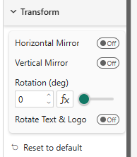
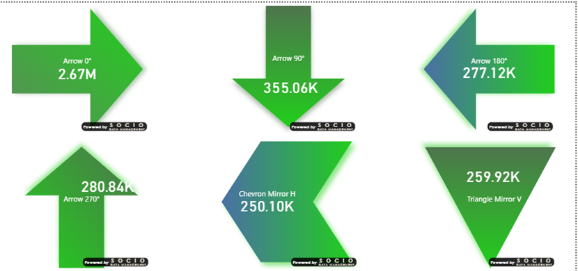

import useBaseUrl from '@docusaurus/useBaseUrl';

# Transform

The **Transform** card applies horizontal/vertical mirroring and free rotation to the shape.

<video autoPlay loop muted playsInline style={{ maxWidth: "100%", border: "1px solid #ccc", borderRadius: "4px" }}>
  <source src={useBaseUrl("/videos/03-Transform.webm")} type="video/webm" />
</video>

## Properties

| Property | Description | Default |
|----------|-------------|---------|
| **Mirror Horizontal** | Flip the shape along its vertical axis | Off |
| **Mirror Vertical** | Flip the shape along its horizontal axis | Off |
| **Rotation (deg)** | Rotation angle, 0–360°. Supports conditional formatting (fx). | 0 |
| **Rotate Text & Logo** | Rotate the text and the logo together with the shape. See [below](#rotate-text--logo) | Off |

## Rotate Text & Logo

By default only the shape rotates: the value, the label and the logo stay upright and readable. With **Rotate Text & Logo** on, the text and the logo are laid out in the shape's *unrotated* frame, then the whole content layer is rotated about the shape's center along with the shape — so a tile turned 90° carries vertical text. Mirroring never mirrors the text, which stays legible. The content follows live while the rotation handle is dragged.

## Why mirroring matters

The **Triangle**, **Arrow** and **Chevron** shapes are defined in a single canonical orientation (pointing right for arrow/chevron, pointing up for triangle). To get the other directions, combine mirroring and rotation:

| Desired direction | Mirror H | Mirror V | Rotation |
|-------------------|:--------:|:--------:|:--------:|
| Arrow → right | — | — | 0° |
| Arrow ← left | Yes | — | 0° |
| Arrow ↑ up | — | — | 270° |
| Arrow ↓ down | — | — | 90° |
| Triangle ▲ up | — | — | 0° |
| Triangle ▼ down | — | Yes | 0° |

## Live rotation handle

In **edit mode**, hover the tile and a small **rotation handle** appears at the top of the shape. Drag it to rotate the tile in real time:

- The path's `transform` attribute is updated continuously during the drag for instant visual feedback
- On drop, the final angle is persisted via Power BI's `persistProperties` API
- The handle is hidden in **view mode**

You can also type the exact rotation in the slider, or drive it from a measure with the **fx** button.
