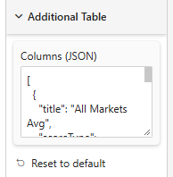

# Additional Table

The **Additional Table** card stores the JSON-backed configuration for [extra columns](./columns), edited through a dedicated dialog rather than typed by hand.

## Opening the editor

1. Select the visual and enter **edit mode** (or focus mode) with at least one measure bound to **Values**
2. Hover the visual — a small **⚙ gear icon** fades in at the top-right corner
3. Click it to open the **Extra Columns** dialog

## Fields per column (up to 8)

Each column's block has a few fields **always visible**, plus two **collapsible sections** (collapsed by default) for the settings you tune less often. Expanding/collapsing a section applies to every column's block at once — expand *Significance* once and it stays open while you configure the rest of your columns.

### Always visible

| Field | Type | Notes |
|-------|------|-------|
| **Column title** | Text | Spans two grid cells in the dialog — accepts `%[Field name]` placeholders, see [A title that follows the data](#a-title-that-follows-the-data) |
| **Score type** | Continuous / Discrete | Default *Continuous* — see [Columns → Continuous vs. Discrete columns](./columns#continuous-vs-discrete-columns) |
| **Score measure** | Measure picker | Required — a column with no Score is skipped entirely |
| **Base** | Measure picker | Optional — hidden when Score type is *Discrete* |
| **Display** | Value / Gap / Value & Gap / Comparison value / Comparison Gap / Comparison Value & Gap | Default *Value* — hidden when Score type is *Discrete* — see [Columns → Display modes](./columns#display-modes) |
| **Precision** | Number (0–6) | Default 0 — hidden when Score type is *Discrete* |
| **Show header** | Checkbox | Default on |

### Format (collapsible)

| Field | Type | Notes |
|-------|------|-------|
| **Font** | Font family | Default Segoe UI |
| **Font size** | Number (6–40) | Default 11 |
| **Font color** | Color | Default #333333 |
| **Bold / Italic / Underline** | Checkboxes | Bold on by default |
| **Column width (px)** | Number (30–300) | Default 76 |
| **Display conversion picto** | Checkbox | Default off — hidden when Score type is *Discrete* — see [Conversion picto](#conversion-picto) below |
| **Separator (border)** | Checkbox | Draws a vertical line on the column's right edge, spanning the funnel's step area |
| **Separator color** | Color | Default #cccccc |

### Significance (collapsible)

| Field | Type | Notes |
|-------|------|-------|
| **Significance level** | Inherit (Significance card) / 90% / 95% / 99% | Default *Inherit* — hidden when Score type is *Discrete* — see [A level per column](#a-level-per-column) below |
| **Independence** | Main separate from comparison / Main is part of comparison / Comparison is part of Main | Default *Main separate from comparison* — hidden when Score type is *Discrete* — the variance method is that of the [Significance](./significance) card — see [Leakage → Independence](./leakage#independence) for what the three options mean |
| **Comparison** | Measure picker | Optional — hidden when Score type is *Discrete* |
| **Comparison base** | Measure picker | Optional — hidden when Score type is *Discrete* |
| **Color above comparison** | Color | Default #cc0000 — hidden when Score type is *Discrete* |
| **Color below comparison** | Color | Default #007700 — hidden when Score type is *Discrete* |
| **Reverse test** | Checkbox | Swaps *above* and *below* for this column — see [Reverse test](#reverse-test) |
| **Display mode** | Font color / Icon / Frame / Background / Free text | Default *Font color* — how a **significant** cell is flagged, see [Significance display](#significance-display) |
| **Custom icon above / below (base64)** | Text | *Icon* mode only — a `data:image/…;base64,…` image; empty = the default triangle tinted with the column's color |
| **Text above / below** | Text | *Free text* mode only — default `+` / `-`; any characters or emoji, empty = no symbol |
| **Add to legend** | Checkbox | Adds this column's significance to the [legend](./leakage#legend) |
| **Legend label** | Text | When *Add to legend* is on — one label for both directions, default "Significantly higher / lower" |

Click **Add column** to append a new one (up to 8 total); an empty state ("No extra columns yet — click *Add column*.") is shown when none exist yet.

:::tip Fields react live to Score type
Switching a column's **Score type** between *Continuous* and *Discrete* immediately shows/hides the fields that only make sense for one of the two — no need to save and reopen the dialog. Existing columns saved before this setting existed default to *Continuous*, so nothing changes for reports created earlier.
:::

## A title that follows the data

A **Column title** typed in the dialog is fixed text. To have it change with the report's filters — the current wave, the number of candidates, a label computed in DAX — use a [title constant](./title-constants): a measure bound through **fx** on the Title Constants card, referenced in the title between `%[` and `]`.

The reference is substituted **inside** the text, so the wording around it is kept:

| Typed in **Column title** | Rendered, `ConstantNum1` = 14 |
|---|---|
| `Rank` | Rank |
| `Rank (/%[ConstantNum1])` | Rank (/14) |
| `%[ConstantNum1]` | 14 |

The picker under the **Column title** box lists the constants currently configured, each with a preview of its value, and inserts the reference for you. Name matching ignores case, spaces and punctuation (`%[ConstantNum1]`, `%[constant_num1]` and `%[CONSTANTNUM1]` are the same constant).

- A name that matches **no** constant is left on screen as `%[Typo]`, so a misspelling is visible rather than silent.
- A constant that resolves to nothing gives an empty string (the column then falls back to "Col *n*", as an untitled column does).

:::tip Why a constant rather than a field in a well
A label measure dropped in a data well is returned for every step and every series — many copies of the same string to carry it once — and it shifts the position of the other measures. A title constant is evaluated outside the wells. Putting the field in a well does still work as a silent fallback (`%[My measure]` resolves against the fields present, taking their first value), but the ⚙ picker deliberately does not offer it.
:::

:::note Why not the *fx* button directly in the dialog?
Power BI's **fx** button is drawn by the host next to a Format-pane slice, and a rule it builds resolves to one value for one property. The ⚙ dialog's columns all share a *single* formatting property (the Additional Table JSON), so fx has nothing to attach to there. The Title Constants card is the way round: the fx buttons live on the card, where the host can draw them, and the dialog references their result.
:::

## A level per column

**Significance level** decides how large this column's gap must be before its cell is flagged. It is left on **Inherit (Significance card)** by default: the column then follows the [Significance](./significance) card's level, so changing that one dropdown still re-judges the whole report — pills and every column at once.

Picking 90%, 95% or 99% instead overrides it **for that column only**. Typical reasons:

- a column read on a **small sub-sample** (one region, one age bracket) where 95% flags almost nothing useful — 90% is the level the study protocol specifies for it;
- a **headline column**, the one the reader will quote, held to 99% while the exploratory columns stay at 95%.

What a level does **not** change is the test itself: the z value, the bases, the Independence adjustment and the variance method are identical — only the threshold the z value is compared against moves (1.645 / 1.96 / 2.576, see [Significance level](./significance#significance-level)). The **Signif. var. method** stays shared by every test of the visual and cannot be set per column, so a leakage and a gap are never computed with different formulas.

:::caution A mixed-level table needs saying so
Two columns side by side flagged at different levels look identical on screen — nothing in the cell says one was judged at 90% and its neighbour at 99%. When you override a column's level, write it in the column title or in its [legend label](#significance-display) (e.g. "Gap vs N-1 (90%)"), otherwise the reader will compare flags that don't mean the same thing.
:::

Columns saved before this field existed carry no level and therefore read as **Inherit** — exactly the behaviour they had.

## Reverse test

The test compares the column's **Score** with its **Comparison**: *above* means Score is significantly higher than Comparison. When the displayed figure is read from the other side, that wording is backwards. Typical case: Score = the N-1 average, Comparison = the current year N, display = **Gap**. A Gap of **-2.8** means N is below N-1 — yet the test says N-1 is significantly *above* N, so the cell would read "significantly higher" next to a negative number, with an arrow pointing the wrong way.

Checking **Reverse test** swaps the two directions for this column only: *Score significantly higher than Comparison* is shown as **below**, and *lower* as **above**. Colors, icons, frames, texts and the legend all follow, so the sign, the arrow and the wording agree. The test itself (z value, level, independence) is unchanged.

## Significance display

A cell is flagged only when its test is significant (**above** or **below** the Comparison); neutral cells stay untouched. The **Display mode** picks how, using the column's **Color above / below comparison**:

| Mode | Result |
|------|--------|
| **Font color** *(default)* | The value is written in the above/below color |
| **Icon** | A triangle (▲ above, ▼ below) tinted with the color — or your own base64 image — right after the value |
| **Frame** | A colored border around the cell |
| **Background** | A light tint of the color behind the cell |
| **Free text** | Characters of your choice (`+`, `-`, a letter, an emoji) in the color, right after the value |

With any mode other than *Font color*, the value itself keeps the column's font color.

**Add to legend** gives the column **one** legend entry: a sample number (123) shown with the *above* decoration then with the *below* one, followed by the **Legend label** prefixed with the column title (e.g. "Gap vs average — Significantly higher / lower"). The entry appears in the [legend](./leakage#legend) below the funnel whether or not the leakage pills or the Leakage legend are on, as long as the column actually runs a significance test.

## Conversion picto

When **Display conversion picto** is on, a small arrow glyph is drawn just in front of (to the left of) the column's value at **every** step, colored by that step's [column-level significance test](./columns#column-level-significance) against its Comparison.

| Test result | Picto color |
|-------------|-------------|
| Significantly **above** the Comparison | **Color above comparison** *(default #cc0000)* |
| Significantly **below** the Comparison | **Color below comparison** *(default #007700)* |
| Neutral, or not tested (Base / Comparison / Comparison base not all set) | Gray *(#888888)* |

- The picto's horizontal space is reserved for the whole column as soon as the option is on, so figures stay aligned from row to row.
- Doesn't apply to *Discrete* columns, which have no significance test to react to.

## Behind the scenes

The dialog persists its entries as a single **JSON array** in the **Columns (JSON)** property of the Additional Table card. Clearing all columns and saving leaves an empty array — the funnel simply renders with no extra columns.
