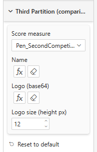

# Third Partition (comparison)

Identical to [Second Partition](./second-partition) — a second, independent competitor/benchmark track. Bind both **Second Partition** and **Third Partition** to show two comparison tracks stacked at each step junction.

## Properties

| Property | Description | Default |
|----------|-------------|---------|
| **Score measure** | The comparison score at each step. Leave unbound to hide the Third Partition entirely. | — |
| **Name** | Short label (only the first ~6 characters are shown) used when no logo is set. Supports conditional formatting (fx). | — |
| **Logo (base64)** | Optional base64 image shown instead of the name | — |
| **Logo size (height px)** | Height of the Third Partition logo | 14 |

See [Second Partition](./second-partition) for how the comparison leakage is computed, and [Competition Leakage](./competition-leakage) for the arrow/text styling shared by both.
