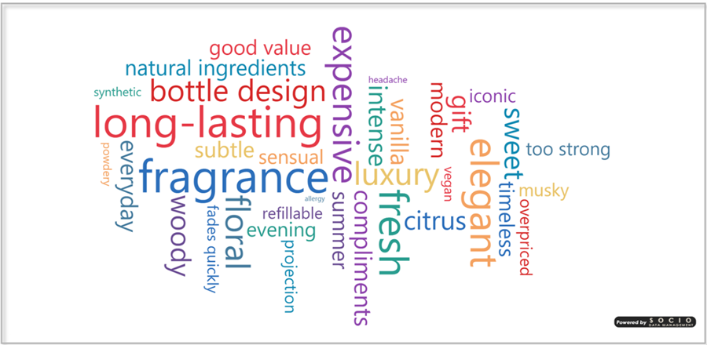

# SDM WordCloud

The **SDM WordCloud** is a custom Power BI visual that turns a text column into a word cloud — and goes one step further: it **tests which words are statistically over- or under-represented** and highlights them, so the cloud reports a finding instead of just drawing a shape.

## Key Features

| Feature | Description |
|---------|-------------|
| **Significance highlighting** | Each word is tested with a two-proportion z-test, either against the **global average** of the cloud or against a **comparison measure** (last period, another segment, a benchmark), at a 90/95/99% confidence level — see [Significance](../03-formatting/significance.md) |
| **Minimum base** | A word whose base is below a threshold is never flagged, so small samples don't produce noisy results |
| **Three highlight styles** | Color only, color + bold, or color + outline, with distinct above / below / neutral colors |
| **Shapes and image masks** | Seven preset silhouettes (circle, square, diamond, triangle, pentagon, star, cardioid) or a plain rectangle, plus a **custom image mask** from a base64 image — see [Background](../03-formatting/background.md) |
| **Size scale** | Linear, square-root or logarithmic, with adjustable min and max font size and spacing |
| **Rotation** | Horizontal only, horizontal + vertical, or free angles; Archimedean or rectangular spiral |
| **Never freezes** | A configurable time budget: placement stops and draws what fits on a very large cloud |
| **Cleaning** | Case normalization, merging of duplicates by sum / count / average, stop words, minimum length — see [Words](../03-formatting/words.md) and [Filtering](../03-formatting/filtering.md) |
| **Limits** | Maximum number of words and minimum value |
| **Live search** | An optional search box (regular expressions) with three behaviors the viewer can switch: highlight, select (cross-filter the page) or filter the cloud |
| **Colors** | Single color, categorical palette, gradient by value, or a **Series Color** measure driving each word |
| **Report interactivity** | Click a word to cross-filter the page, hover for a tooltip, right-click for the Power BI menu — see [Interactivity](#interactivity) |
| **Entrance animation** | Fade, Grow or Cascade, replayed only when the data changes — see [Animation](../03-formatting/animation.md) |
| **Localization** | Format pane localized in 10 languages |
| **Licensing & watermark** | Free / Pro plans, watermark removed with a valid key |

## Interactivity

Every word is a data point of the **Words** column.

| Gesture | What happens |
|---------|--------------|
| **Click a word** | Selects it and cross-filters the other visuals on the page. Unselected words dim to the [Selection](../03-formatting/selection.md) opacity |
| **Ctrl / ⌘ + click** | Adds the word to the selection |
| **Click elsewhere** | Clears the selection |
| **Hover a word** | Tooltip with the word, its value, its base, the comparison and its base when bound, then any measure of the [Tooltips](../02-getting-started/data-roles.md#tooltips) role |
| **Right-click a word** | Standard Power BI context menu |

Selections and the context menu respect the report's *Edit interactions* settings.

## Editions

| Feature | Free | Pro |
|---------|------|-----|
| All features | Yes | Yes |
| Watermark | Shown | Hidden |
| Support | Community | Email |

## When to use it

The WordCloud is built for text where the question is not *which words are frequent* but ***which words are unusually frequent***:

- Open-ended survey answers, compared between segments or waves
- Verbatim and review analysis
- Social listening, this period against the previous one
