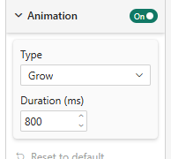

# Animation

The **Animation** card plays a short **entrance animation** when the cloud appears or when its data changes.

## Properties

| Property | Description | Default |
|----------|-------------|---------|
| **Animation** (card toggle) | Turns the entrance animation on or off | On |
| **Type** | **Fade**: the whole visual fades in. **Grow**: the words are drawn first, then the details fade in. **Cascade**: a staggered variant of Grow | Grow |
| **Duration (ms)** | Duration of the main animation, 100–5000 ms | 800 |

## When it plays — and when it does not

The animation is an *entrance*: the cloud is redrawn from scratch on every update. It is **only replayed when the data changes**, and skipped for:

- a **resize**, a click in the Format pane, a selection or a live search — anything that leaves the data untouched;
- an **export** (PDF, PowerPoint, image, subscriptions);
- viewers whose operating system asks for **reduced motion**.
