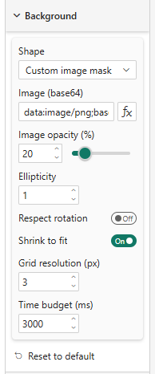
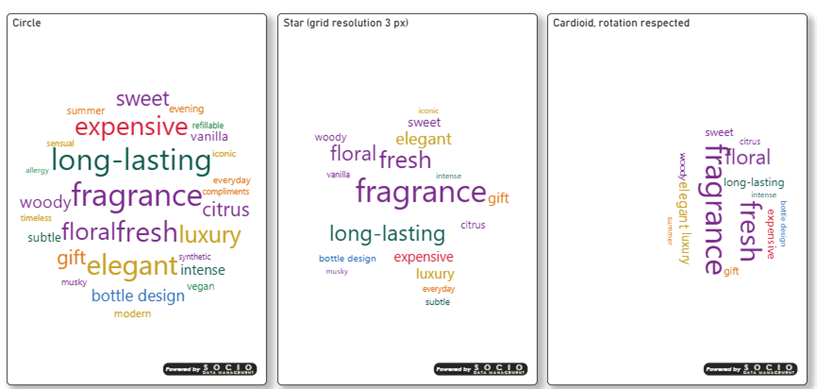
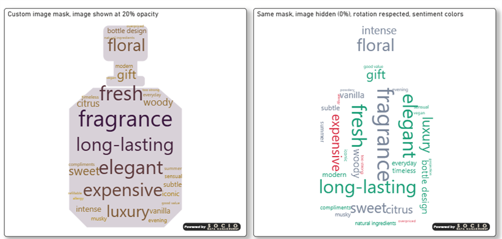

# Background

The **Background** card pours the cloud into a **silhouette**: a preset shape or the shape of an image you provide. With **None**, the cloud simply fills the rectangle of the visual.

## Properties

| Property | Description | Default |
|----------|-------------|---------|
| **Shape** | *None (rectangular cloud)*, *Circle*, *Square*, *Diamond*, *Triangle*, *Pentagon*, *Star*, *Cardioid* or *Custom image mask* | None |
| **Image (base64)** | The image used as mask and drawn behind the words when Shape is *Custom image mask*. Supports **fx**, so it can come from a measure | *(empty)* |
| **Image opacity (%)** | Opacity of the image drawn behind the words, 0–100 | 25 |
| **Ellipticity** | Width / height stretch of a preset shape (ignored for an image mask) | 1 |
| **Respect rotation** | See [below](#respect-rotation) | Off |
| **Shrink to fit** | Shrinks a word toward **Layout → Min font size** before giving up on placing it | On |
| **Grid resolution (px)** | Precision of the placement grid. Smaller = denser and more precise, larger = faster | 4 |
| **Time budget (ms)** | Placement stops and draws whatever fits once this budget is exceeded | 3000 |

## Custom image mask

Paste a base64-encoded image into **Image (base64)**. The non-transparent part of the image is where words may be placed; the image itself is drawn behind the cloud at the chosen opacity. A logo or a country outline with a transparent background works best. The image is sanitized before use and is never injected as HTML.

## Respect rotation

By default words stay **horizontal** in shape mode, which is fast and robust. Turning **Respect rotation** on honors [Layout → Rotation](./layout) but makes every collision check slower, so the cloud may need a larger time budget.

## Never freezes

If a very large cloud takes longer than the **Time budget**, placement stops and the words that already fit are drawn. Words that did not fit are left out; raise the budget, lower Max words, lower the grid precision (larger value) or turn **Shrink to fit** on to include more of them.
