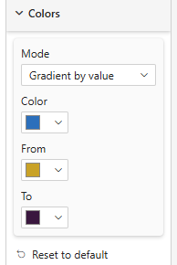
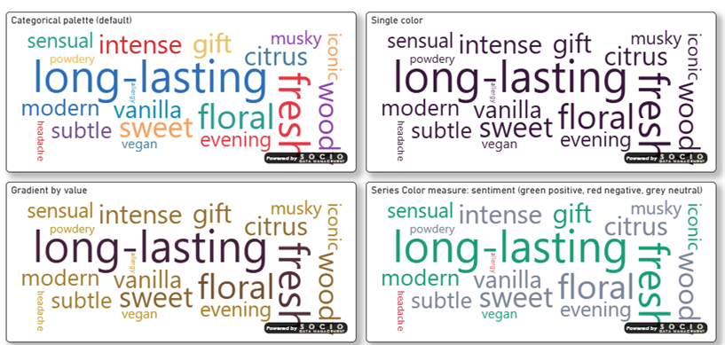

# Colors

The **Colors** card sets how words are colored when no other rule takes over.

## Properties

| Property | Description | Default |
|----------|-------------|---------|
| **Mode** | *Single color*, *Categorical palette*, *Gradient by value* or *Series Color measure* | Categorical palette |
| **Color** | The color of every word in *Single color* mode (also the fallback in *Series Color measure* mode) | #2C6FBB |
| **From** | Color of the smallest value in *Gradient by value* mode | #2C6FBB |
| **To** | Color of the largest value in *Gradient by value* mode | #E63946 |

## What overrides this card

Colors from this card are the **last** in the priority order:

1. a **Series Color** measure value for the word;
2. the [Significance](./significance) colors, as soon as a test is selected;
3. this card.

So while a significance test is on, the Colors card has no visible effect; set **Significance → Test** to *None* to see it again.
