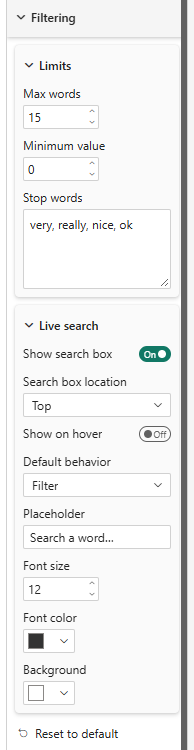
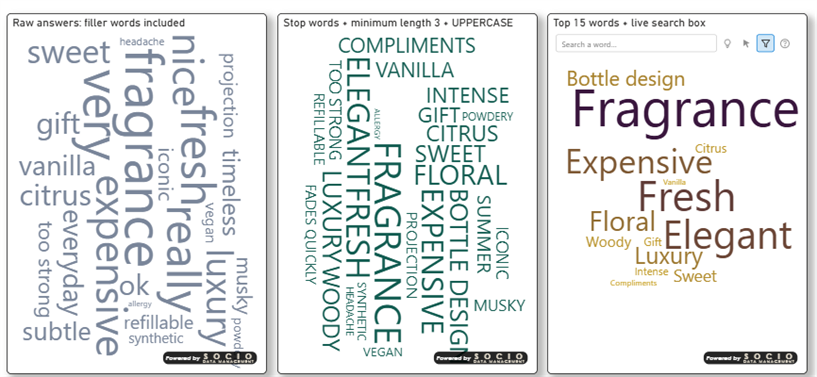

# Filtering

The **Filtering** card is a composite card with two groups: **Limits** and **Live search**.

## Limits

| Property | Description | Default |
|----------|-------------|---------|
| **Max words** | Number of words kept, largest values first | 100 |
| **Minimum value** | Words whose (merged) value is below this are dropped | 0 |
| **Stop words** | Comma-separated words excluded from the cloud (case-insensitive), e.g. `the, and, a, of` | *(empty)* |

## Live search

An optional search box to find words in the cloud. The search is **client-side only**: nothing is saved with the report, and the text is kept until the page is reloaded.

| Property | Description | Default |
|----------|-------------|---------|
| **Show search box** | Displays the box on the visual | Off |
| **Search box location** | *Top* or *Bottom* of the visual | Top |
| **Show on hover** | On: the box floats over the cloud and appears when the pointer is over the visual (in design and reading modes). Off: the box is always visible and reserves its own strip, so it never covers the words | Off |
| **Default behavior** | Initial behavior of the search: *Highlight*, *Select* or *Filter* (see below) | Filter |
| **Placeholder** | Hint text of the empty box | Search words… |
| **Font size** | Size of the typed text | 12 |
| **Font color** | Color of the typed text | #333333 |
| **Background** | Background color of the box | #ffffff |

### Behaviors

| Icon | Behavior | Effect |
|------|----------|--------|
| 💡 Light bulb | **Highlight** | Matching words stay lit, the others are dimmed (same opacity as *unselected* words, see [Selection](./selection)) |
| ➤ Arrow | **Select** | Same as Highlight, and the matching words are **selected**: the other visuals of the page are cross-filtered, as if you had clicked the words. Clearing the search clears the selection |
| ⛛ Funnel | **Filter** | Only the matching words are drawn, and the cloud is laid out again |

The box ends with these three buttons, so the end-user can switch behavior on the fly. Only one is active at a time. *Default behavior* is the starting choice; if you change it in the Format pane, any choice made by the viewer is reset.

A fourth button, **?**, opens a help window (in the language of the user) that explains the icons and gives a few regular-expression tips.

### Regular expressions

The text typed is a **regular expression**, matched anywhere in the word and ignoring case.

| Pattern | Matches |
|---------|---------|
| `paris\|lyon` | "paris" **or** "lyon" — the way to filter on two names |
| `^data` | words starting with "data" |
| `ing$` | words ending with "ing" |
| `^(paris\|lyon)$` | exactly "paris" or exactly "lyon" |
| `colou?r` | "color" or "colour" (`?` makes the previous letter optional) |
| `a.*z` | "a", then anything, then "z" |

An incomplete pattern (for example an unclosed parenthesis while typing) is searched as plain text, so no error is shown.

