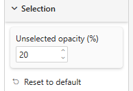
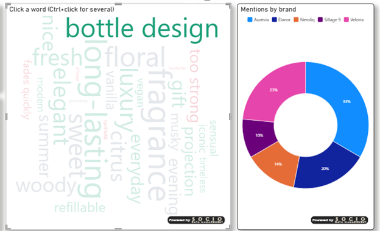

# Selection

Clicking a word selects it and cross-filters the other visuals of the page (Ctrl / ⌘ + click adds to the selection, a click elsewhere clears it).

## Properties

| Property | Description | Default |
|----------|-------------|---------|
| **Unselected opacity (%)** | Opacity of the words that are not selected, 0–100 | 30 |

Selections follow the report's *Edit interactions* settings; where interactions are switched off, clicks and the context menu are inert.
