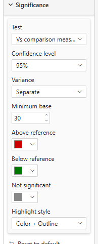
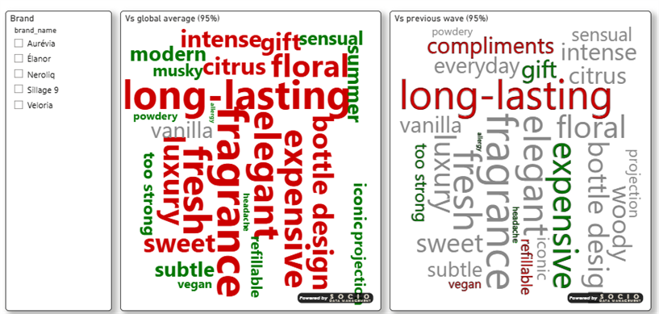

# Significance

The **Significance** card decides which words are **significantly more or less frequent** than a reference, and how they are highlighted.

## Properties

| Property | Description | Default |
|----------|-------------|---------|
| **Test** | *None*, *Vs global average* or *Vs comparison measure* — see [below](#the-two-tests) | None |
| **Confidence level** | 90%, 95% or 99% | 95% |
| **Variance** | *Pooled* or *Separate* — see [Variance](#variance) | Separate |
| **Minimum base** | Words whose Base is below this are never flagged | 30 |
| **Above reference** | Color of a word significantly above the reference | #cc0000 |
| **Below reference** | Color of a word significantly below the reference | #007700 |
| **Not significant** | Color of every other word | #888888 |
| **Highlight style** | *Color only*, *Color + Bold* or *Color + Outline* (a significant word only) | Color + Bold |

## The two tests

Both are a **two-proportion z-test**: `z = (p1 − p2) / √variance`, where `p1 = Value / Base` for the word.

### Vs global average

The reference is the rest of the cloud: `p2 = (total Value − word Value) / (total Base − word Base)`. The word is **left out** of its own reference, so it is never compared against a total that contains itself. The totals are computed on all the words that remain after cleaning, before Max words is applied. Needs **Base**.

### Vs comparison measure

The reference is the word's own `p2 = Comparison / Comparison Base`: last period, another segment, a benchmark. Needs **Base**, **Comparison** and **Comparison Base**.

In both modes the word stays *Not significant* when its Base is below **Minimum base** or when the reference base is zero.

## Variance

The two methods give close results when the bases are similar and the proportions not extreme.

| Method | Variance | Reads as |
|--------|----------|----------|
| **Separate** *(default)* | `p1(1−p1)/n1 + p2(1−p2)/n2` | Each proportion keeps its own variance |
| **Pooled** | `p(1−p)(1/n1 + 1/n2)`, with `p` the pooled proportion | Variance under the hypothesis that both proportions are equal |

## Colors while a test is on

As soon as **Test** is not *None*, every word takes one of the three significance colors, whatever the [Colors](./colors) card says. Only a **Series Color** measure can still override them.
